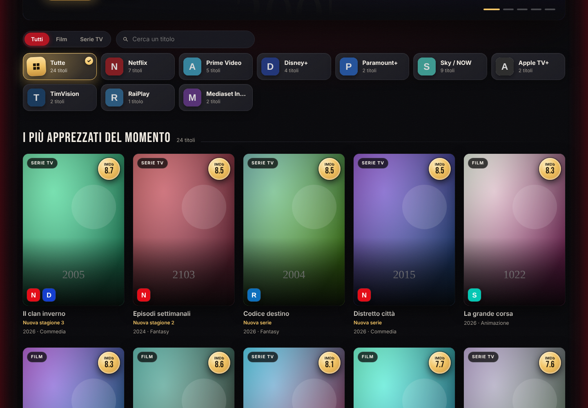

# 🎬 CosaGuardo

**Le ultime uscite in streaming in Italia, in un unico posto.**

CosaGuardo raccoglie i film e le serie TV appena usciti sulle piattaforme italiane (Netflix, Prime Video, Disney+, Sky/NOW, Paramount+, Apple TV+, TimVision, RaiPlay, Mediaset Infinity, discovery+) e li mostra in un'interfaccia in stile sala cinematografica.

- **Solo il catalogo italiano**: regione `IT`, titoli, trame e generi in italiano.
- **Nessun doppione**: un titolo disponibile su più piattaforme compare una sola volta, con il logo di ciascuna piattaforma.
- **Sempre aggiornato**: il catalogo si aggiorna da solo ogni ora (configurabile), e la pagina si ricarica quando ci sono novità.
- **Di tendenza in Italia**: la classifica dei titoli più visti della settimana disponibili sulle piattaforme italiane.
- **Prossimamente**: i film e le serie in arrivo sulle piattaforme italiane nei prossimi 60 giorni, con la data di uscita e un calendario per settimana e per mese.
- **Da non perdere**: i film e le serie più votati usciti negli ultimi 6 mesi, già disponibili in Italia e con la scheda in italiano. Il voto è quello di **IMDb**, più affidabile perché dato da molte più persone.
- Filtri per film o serie e per piattaforma, ricerca per titolo, schede con trama, voto e link "dove guardarlo".
- Le serie hanno un'etichetta che dice cosa c'è di nuovo: *Nuova serie*, *Nuova stagione* o *Nuovi episodi*.
- **Trailer** nella scheda di ogni titolo, in italiano quando c'è.
- **Richieste**: un pulsante "Richiedi" manda i film a **Radarr** e le serie a **Sonarr**, che li cercano e li scaricano. Per le serie scegli se richiedere tutte le stagioni o solo alcune. La sezione *Le mie richieste* mostra lo stato di ognuna, il progresso del download con il tempo rimanente e gli episodi scaricati per stagione.
- **Plex**: se colleghi il tuo server Plex, CosaGuardo segna i titoli che hai già, mostra quante stagioni ed episodi ci sono e apre il titolo in Plex con un clic.


| Prossimamente | Da non perdere |
|---|---|
|  |  |

| Di tendenza in Italia | Scheda del titolo | Mobile |
|---|---|---|
|  |  |  |

> Gli screenshot sono stati fatti con dati di prova (locandine segnaposto). Con la chiave TMDB vedrai locandine e titoli reali.

## Avvio rapido

Serve solo Docker, senza scaricare niente:

```bash
docker run -d --name cosaguardo -p 8080:8080 -v cosaguardo-data:/data --restart unless-stopped ghcr.io/land2595/cosaguardo:latest
```

Apri **http://localhost:8080**. Al primo avvio la pagina ti chiede la chiave TMDB, che è gratuita: crei un account su [themoviedb.org](https://www.themoviedb.org/signup), la richiedi da [Impostazioni → API](https://www.themoviedb.org/settings/api) e la incolli. La chiave viene salvata nel volume `cosaguardo-data`, quindi resta anche dopo un riavvio o un aggiornamento. Il primo caricamento del catalogo richiede circa 30 secondi.


L'immagine è disponibile sia per `amd64` sia per `arm64`, quindi gira anche su Raspberry Pi, NAS e Mac con Apple Silicon.

### Con Docker Compose

Crea un file `docker-compose.yml` con questo contenuto (è lo stesso che trovi nel repository) e lancia `docker compose up -d`:

```yaml
services:
  cosaguardo:
    image: ghcr.io/land2595/cosaguardo:latest
    container_name: cosaguardo
    restart: unless-stopped
    ports:
      - "8080:8080"
    environment:
      TMDB_API_KEY: ""   # facoltativa: se vuota si inserisce dalla pagina
    volumes:
      - cosaguardo-data:/data

volumes:
  cosaguardo-data:
```

### Aggiornare

```bash
# con docker run
docker pull ghcr.io/land2595/cosaguardo:latest && docker rm -f cosaguardo
# poi rilancia il comando docker run qui sopra

# con docker compose
docker compose pull && docker compose up -d
```

## Richieste a Radarr e Sonarr

Se usi [Radarr](https://radarr.video) e [Sonarr](https://sonarr.tv), CosaGuardo può mandare loro i titoli che vuoi vedere. Basta aggiungere indirizzo e chiave API, che trovi in *Settings → General* di ciascuno:

```bash
docker run -d --name cosaguardo -p 8080:8080 -v cosaguardo-data:/data --restart unless-stopped \
  -e RADARR_URL=http://192.168.1.10:7878 -e RADARR_API_KEY=la_chiave_di_radarr \
  -e SONARR_URL=http://192.168.1.10:8989 -e SONARR_API_KEY=la_chiave_di_sonarr \
  ghcr.io/land2595/cosaguardo:latest
```


Puoi configurarne anche uno solo. Nella scheda di un titolo compare il pulsante **Richiedi a Radarr** (per i film) o **Richiedi a Sonarr** (per le serie): il titolo viene aggiunto con monitoraggio attivo e la ricerca parte subito. Se è già presente, il pulsante mostra lo stato invece di aggiungerlo di nuovo.


- **Stagioni**: per le serie si apre l'elenco delle stagioni, con il numero di episodi e quanti ne hai già su Plex. Puoi sceglierne alcune o tutte. Più avanti puoi aggiungerne altre con **＋ Altre stagioni**: Sonarr le monitora e le cerca subito.
- **Download**: la scheda e *Le mie richieste* mostrano la percentuale, il tempo rimanente e, per le serie, gli episodi scaricati per ogni stagione. Mentre c'è un download in corso la pagina si aggiorna da sola ogni 15 secondi.

- Usa l'indirizzo IP del computer o NAS, non `localhost`: dentro il container `localhost` è il container stesso. Se Radarr e Sonarr sono nella stessa rete Docker di CosaGuardo puoi usare il nome del container, ad esempio `http://radarr:7878`.
- Se non indichi profilo di qualità e cartella, vengono usati i primi configurati in Radarr/Sonarr. Puoi sceglierli per nome con `RADARR_QUALITY_PROFILE=HD-1080p` e `RADARR_ROOT_FOLDER=/movies` (lo stesso per Sonarr).
- Funziona con Radarr v3 o successivi e con Sonarr v3 e v4.

## Collegare Plex

Con Plex collegato, le locandine dei titoli che hai già mostrano **Su Plex**, e la scheda dice quante stagioni ed episodi hai e ha il pulsante **Apri in Plex**. Servono l'indirizzo del server e il token:

```bash
  -e PLEX_URL=http://192.168.1.10:32400 -e PLEX_TOKEN=il_tuo_token \
```

Per trovare il token: apri Plex Web, su un qualsiasi film clicca **⋯ → Ottieni informazioni → Visualizza XML**. Nell'indirizzo della pagina che si apre, il token è il valore dopo `X-Plex-Token=`. ([Guida ufficiale](https://support.plex.tv/articles/204059436-finding-an-authentication-token-x-plex-token/))

CosaGuardo legge la libreria ogni 10 minuti e riconosce i titoli dagli id TMDB e TVDB, quindi funziona con l'agente Plex predefinito.

## Configurazione

Tutte le opzioni sono variabili d'ambiente (`-e NOME=valore` con `docker run`, oppure la sezione `environment` del compose). Nessuna è obbligatoria.

| Variabile | Predefinito | Descrizione |
|---|---|---|
| `TMDB_API_KEY` | | Chiave TMDB (v3) o token di lettura (v4). Se manca, la pagina la chiede al primo avvio. |
| `REFRESH_MINUTES` | `60` | Ogni quanti minuti aggiornare il catalogo. |
| `MOVIE_DAYS` | `90` | Un film è "uscita recente" se è uscito negli ultimi N giorni. |
| `TV_DAYS` | `30` | Una serie è "uscita recente" se ha avuto episodi negli ultimi N giorni. |
| `PLATFORMS` | tutte | Piattaforme da mostrare, separate da virgola: `netflix,prime,disney,paramount,sky,apple,timvision,raiplay,mediaset,discovery`. |
| `PAGES` | `5` | Pagine di risultati lette da TMDB per ogni ricerca (20 titoli per pagina). |
| `REGION` / `LANGUAGE` | `IT` / `it-IT` | Paese del catalogo e lingua dei metadati. |
| `RADARR_URL` / `RADARR_API_KEY` | | Indirizzo e chiave API di Radarr, per richiedere i film. |
| `RADARR_QUALITY_PROFILE` / `RADARR_ROOT_FOLDER` | il primo | Profilo di qualità e cartella dei film (nome o id). |
| `SONARR_URL` / `SONARR_API_KEY` | | Indirizzo e chiave API di Sonarr, per richiedere le serie. |
| `SONARR_QUALITY_PROFILE` / `SONARR_ROOT_FOLDER` | il primo | Profilo di qualità e cartella delle serie (nome o id). |
| `SONARR_LANGUAGE_PROFILE` | il primo | Solo Sonarr v3: profilo lingua (nome o id). |
| `PLEX_URL` / `PLEX_TOKEN` | | Indirizzo del server Plex e token, per vedere cosa hai già. |
| `IMDB_RATINGS` | `1` | Usa i voti IMDb in *Da non perdere*. Con `0` usa solo quelli di TMDB e non scarica niente. |
| `UPCOMING_DAYS` | `60` | Quanti giorni avanti guarda la sezione *Prossimamente*. |
| `PUID` / `PGID` | `1000` / `1000` | Utente e gruppo con cui gira l'app e a cui appartengono i file in `/data`. Utile se monti una cartella del NAS (es. `-v /percorso/cosaguardo:/data`). |

Hulu non è presente perché non esiste in Italia: i suoi contenuti escono su Disney+.

## Come funziona

Ad ogni aggiornamento, CosaGuardo:

1. legge da TMDB l'elenco dei servizi di streaming attivi in Italia e li raggruppa per piattaforma (ad esempio "Netflix" e "Netflix con pubblicità" diventano un'unica piattaforma Netflix);
2. cerca i **film** usciti di recente e quelli arrivati in **digitale/TV in Italia** di recente, disponibili in abbonamento o gratis su quelle piattaforme;
3. cerca le **serie** nuove e quelle con **episodi o stagioni nuove**;
4. per ogni titolo legge la scheda in italiano e le piattaforme italiane su cui è disponibile, poi unisce i doppioni;
5. ordina tutto dalla data di uscita più recente e salva il risultato in `/data/catalogo.json`, così al riavvio la pagina è subito pronta.

Per **Prossimamente** cerca i film con uscita digitale o TV in Italia nelle prossime settimane e le serie (nuove o con una nuova stagione) che debuttano sulle reti delle piattaforme. **Da non perdere** prende i film e le serie (nuove o con una stagione nuova) usciti negli ultimi 6 mesi, disponibili in abbonamento o gratis su una piattaforma italiana e con la trama tradotta in italiano. Esclude reality, talk show, notiziari, soap e programmi per bambini. Il voto viene dal [dataset ufficiale di IMDb](https://developer.imdb.com/non-commercial-datasets/), scaricato una volta al giorno in `/data` (circa 8 MB): servono almeno 3.000 voti per un film e 1.000 per una serie, e il voto minimo è 7. La classifica usa la media pesata di IMDb, così un titolo con pochi voti non scavalca uno votato da decine di migliaia di persone. Se IMDb non è raggiungibile, o un titolo non c'è ancora, si usa il voto di TMDB.

I dati di disponibilità arrivano da [JustWatch](https://www.justwatch.com/it) tramite le API di [TMDB](https://www.themoviedb.org).

**Un limite da sapere:** TMDB non indica il giorno in cui un titolo è stato aggiunto a una piattaforma. Per i film CosaGuardo usa la data di uscita digitale in Italia quando c'è (altrimenti la data di uscita), per le serie la data dell'ultimo episodio. Un film vecchio appena aggiunto al catalogo di una piattaforma quindi non compare tra le ultime uscite.

Per i titoli **in arrivo** TMDB non sa ancora su quale piattaforma usciranno. CosaGuardo lo ricava dalla nota di uscita italiana, dalla casa di produzione (es. Netflix, Disney, Apple) o dalla rete che produce la serie. Qualche titolo, soprattutto Sky Original, può quindi comparire senza piattaforma o mancare.

## API

| Endpoint | Descrizione |
|---|---|
| `GET /api/catalogo` | Ultime uscite, prossimamente, da non perdere, tendenze e piattaforme. Filtri opzionali: `tipo=movie\|tv`, `piattaforma=netflix` (ripetibile), `q=titolo`. |
| `GET /api/stato` | Ora dell'ultimo aggiornamento ed eventuali errori. |
| `POST /api/aggiorna` | Forza un aggiornamento immediato. |
| `GET /api/trailer/{movie\|tv}/{id}` | Il trailer YouTube del titolo, in italiano se disponibile. |
| `GET /api/richieste` | Le richieste fatte, con stato, download in corso e presenza su Plex. |
| `GET /api/richieste/{id}` | Stato di un titolo (es. `tv-123`): Radarr/Sonarr, download e Plex. |
| `GET /api/serie/{tmdb_id}/stagioni` | Le stagioni di una serie, con episodi richiesti, scaricati e presenti su Plex. |
| `POST /api/richieste` | Richiede un titolo (`{"id": "movie-123"}`): i film vanno a Radarr, le serie a Sonarr. Per le serie puoi indicare le stagioni: `{"id": "tv-123", "stagioni": [1, 2]}` (senza, le richiede tutte). |
| `GET /api/plex` | Gli id TMDB dei film e delle serie già presenti su Plex. |
| `POST /api/chiave` | Imposta la chiave TMDB (solo se non è ancora configurata). |
| `GET /health` | Controllo di salute per Docker. |

## Sviluppo

```bash
git clone https://github.com/land2595/cosaguardo.git && cd cosaguardo
docker build -t cosaguardo .        # immagine locale

pip install -r requirements.txt pytest
pytest -q tests

# Prova senza chiave e senza rete, con finti TMDB, Radarr e Sonarr
uvicorn tests.mock_tmdb:app --port 9000 &
uvicorn tests.mock_arr:radarr --port 7878 &
uvicorn tests.mock_arr:sonarr --port 8989 &
uvicorn tests.mock_arr:plex --port 32400 &
TMDB_API_KEY=test TMDB_BASE_URL=http://127.0.0.1:9000 \
TMDB_IMAGE_URL=http://127.0.0.1:9000/img DATA_DIR=./data \
RADARR_URL=http://127.0.0.1:7878 RADARR_API_KEY=test \
SONARR_URL=http://127.0.0.1:8989 SONARR_API_KEY=test \
PLEX_URL=http://127.0.0.1:32400 PLEX_TOKEN=plex-test \
uvicorn app.main:app --reload --port 8080
```

Struttura:

```
app/
  config.py      piattaforme e impostazioni
  catalog.py     raccolta dati da TMDB, unione dei doppioni, trailer, cache
  arr.py         richieste a Radarr e Sonarr
  main.py        server FastAPI e aggiornamento periodico
  static/        interfaccia (HTML, CSS, JS, font)
tests/           test e finto server TMDB
```

---

Questo prodotto usa le API di TMDB ma non è approvato né certificato da TMDB. I font Bebas Neue e Inter sono distribuiti con licenza SIL Open Font License.
