# 🎬 CosaGuardo

**Le ultime uscite in streaming in Italia, in un unico posto.**

CosaGuardo raccoglie i film e le serie TV appena usciti sulle piattaforme italiane (Netflix, Prime Video, Disney+, Sky/NOW, Paramount+, Apple TV+, TimVision, RaiPlay, Mediaset Infinity, discovery+) e li mostra in un'interfaccia in stile sala cinematografica.

- **Solo il catalogo italiano**: regione `IT`, titoli, trame e generi in italiano.
- **Nessun doppione**: un titolo disponibile su più piattaforme compare una sola volta, con il logo di ciascuna piattaforma.
- **Sempre aggiornato**: il catalogo si aggiorna da solo ogni ora (configurabile), e la pagina si ricarica quando ci sono novità.
- **Di tendenza in Italia**: la classifica dei titoli più visti della settimana disponibili sulle piattaforme italiane.
- **Prossimamente**: i film e le serie in arrivo sulle piattaforme italiane nei prossimi 60 giorni, con la data di uscita e un calendario per settimana e per mese.
- **I migliori**: la classifica dei film e delle serie migliori di un anno (es. il 2024) o degli ultimi 3, 5 o 10 anni, già disponibili in Italia e con la scheda in italiano, **ordinati per voto di Rotten Tomatoes** (con una chiave gratuita OMDb; senza, si usa il voto IMDb). I contenuti per bambini (animazione e film per famiglie, serie per bambini) sono esclusi, ma con **＋ Includi contenuti per bambini** li aggiungi alla classifica.
- **Bambini**: i film e le serie più popolari adatti ai bambini fino a 12 anni.
- Filtri per film o serie, per **categoria** (commedia, avventura, azione, animazione...) e per piattaforma in tutte le sezioni, ricerca per titolo, schede con trama, voto e link "dove guardarlo".
- Le serie hanno un'etichetta che dice cosa c'è di nuovo: *Nuova serie*, *Nuova stagione* o *Nuovi episodi*.
- **Generi e attori principali** nella scheda di ogni titolo. Tocca un attore per vedere **tutti i film e le serie** in cui ha recitato, dal più recente, e aprire la scheda di ognuno.
- **Trailer** nella scheda di ogni titolo, in italiano quando c'è.
- **Richieste**: un pulsante "Richiedi" manda i film a **Radarr** e le serie a **Sonarr**, che li cercano e li scaricano. Per le serie scegli se richiedere tutte le stagioni o solo alcune. La sezione *Le mie liste → Richieste* mostra lo stato di ognuna, il progresso del download con il tempo rimanente e gli episodi scaricati per stagione.
- **Plex**: se colleghi il tuo server Plex, CosaGuardo segna i titoli che hai già, mostra stagione per stagione quanti episodi hai e apre il titolo in Plex con un clic.
- **Menu admin con PIN**: dall'ingranaggio in alto a destra scegli i tag di Sonarr e Radarr da applicare ai titoli che aggiungi, il profilo di qualità e la cartella.
- **Stato della serie**: la scheda di ogni serie dice quando esce la prossima stagione (o il prossimo episodio) oppure se la serie è terminata o cancellata.
- **Voti IMDb e Rotten Tomatoes con la media**: ogni locandina mostra la media dei due voti (in decimi), la scheda li mostra tutti e tre.
- **Watchlist**: dalla scheda di un titolo scegli se richiederlo subito o metterlo nella watchlist con **＋ Watchlist**, tra le cose che vorresti vedere. Lo ritrovi in *Le mie liste → Da vedere*, con il pulsante per richiederlo quando vuoi.
- **Non mi interessa**: i film e le serie che sicuramente non guarderai spariscono da tutte le sezioni e non ti vengono più suggeriti. Si ripristinano da *Le mie liste → Ignorati*.
- **Cancella**: in *Le mie liste → Richieste* puoi togliere i titoli già richiesti per fare pulizia. Viene tolto solo dalla schermata di CosaGuardo: Plex, Radarr e Sonarr non vengono toccati.
- **Il tuo giudizio**: metti *mi piace* a film e serie, dai un voto da 0 a 5 stelle e scrivi nelle note cosa ti è piaciuto. Con l'AI collegata, **✦ Suggerisci con l'AI** propone tre note brevissime (al massimo 20 parole) da aggiungere con un tocco; parte solo quando premi il pulsante.
- **Suggeriti per te**: film e serie degli ultimi 50 anni scelti per te da un'AI in base a mi piace, voti e note, ognuno con il motivo. Puoi usare **Claude** (Anthropic) o qualsiasi servizio con API compatibile OpenAI, come **OpenRouter**, OpenAI o un server locale. Senza chiave usa i titoli consigliati da TMDB.
- **Già visti da Yamtrack e/o Plex**: i titoli già visti vengono segnati, non ti vengono suggeriti di nuovo e i tuoi voti aiutano a capire i tuoi gusti. Puoi usare solo Yamtrack, solo Plex o tutti e due.

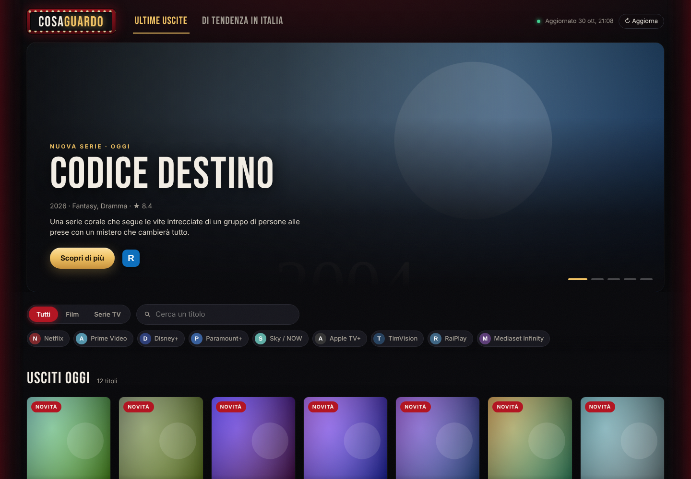

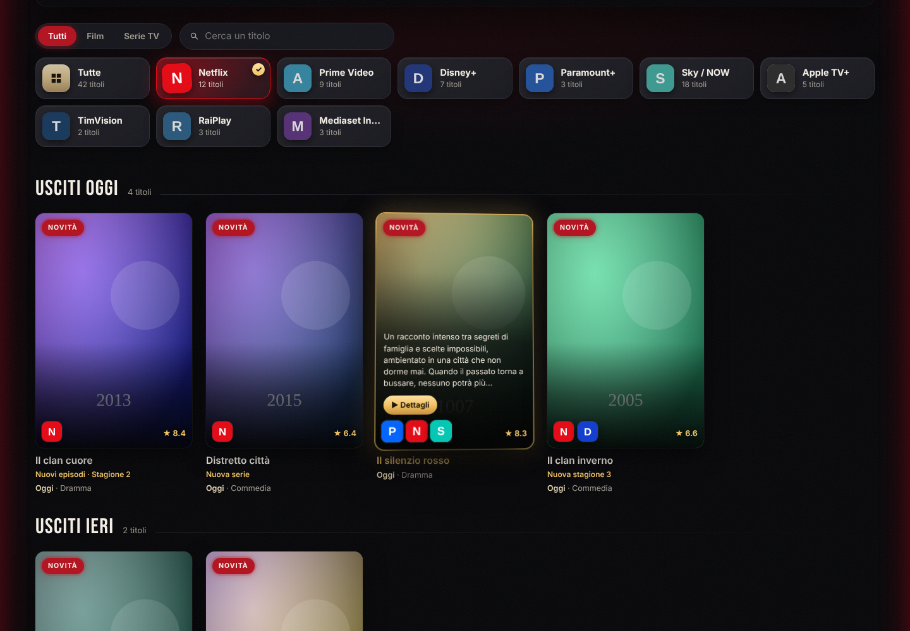

| Prossimamente | I migliori |
|---|---|
| 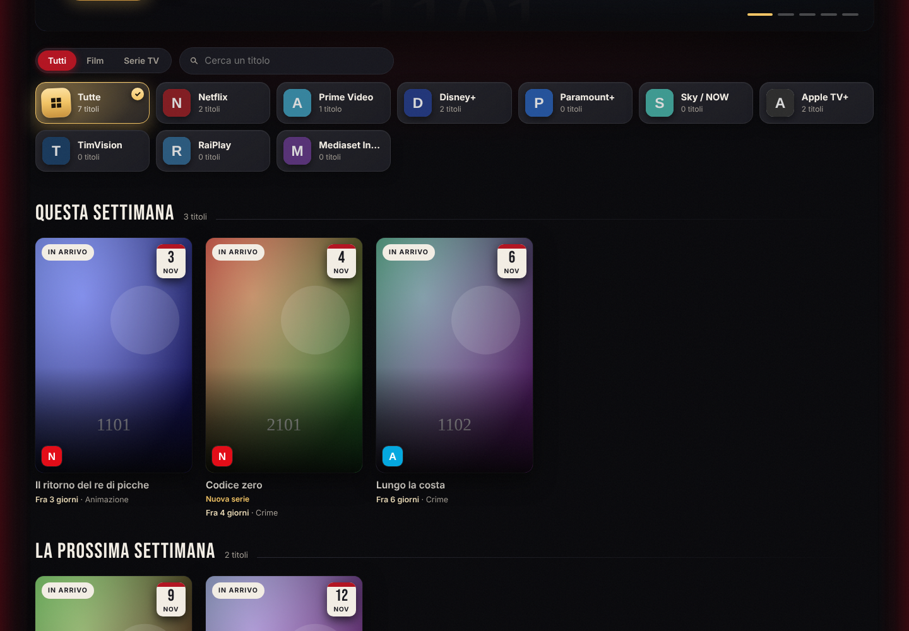 | 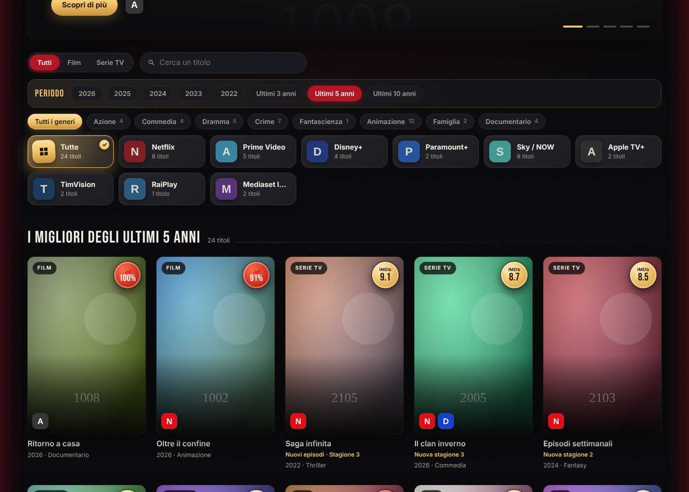 |

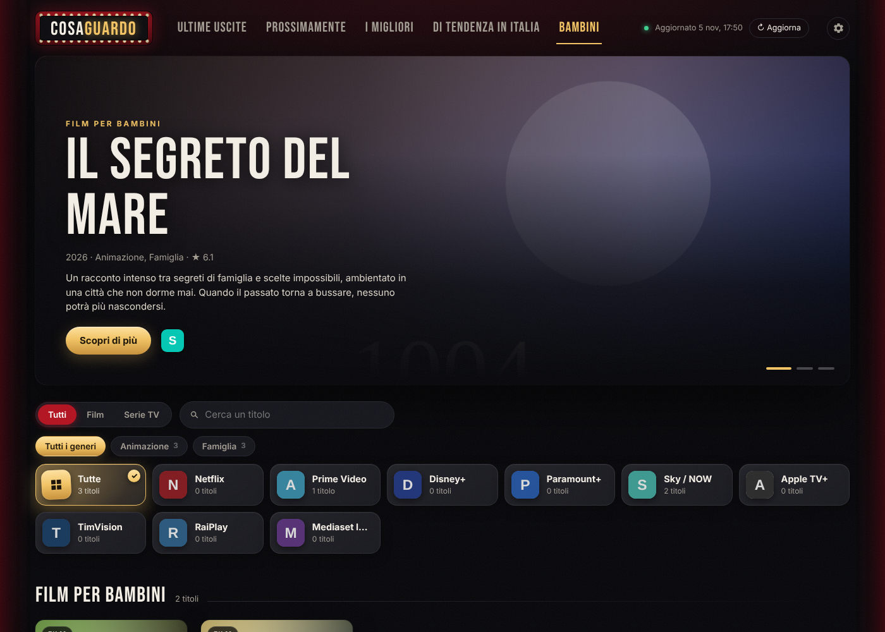

| Di tendenza in Italia | Scheda del titolo | Mobile |
|---|---|---|
| 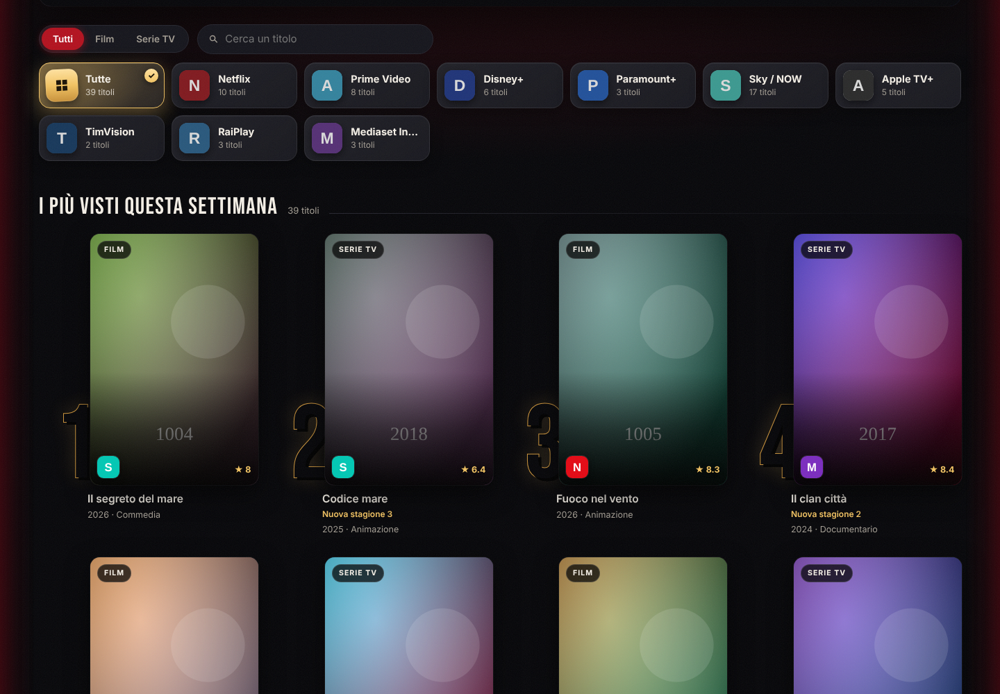 | 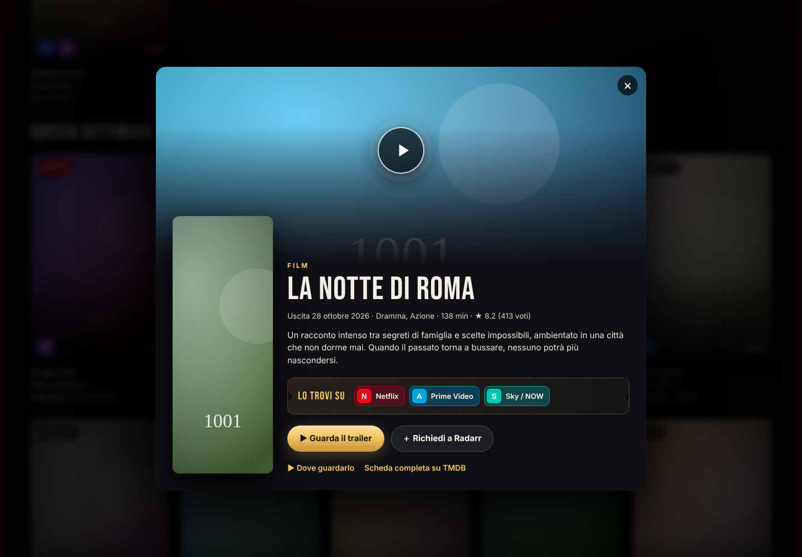 | 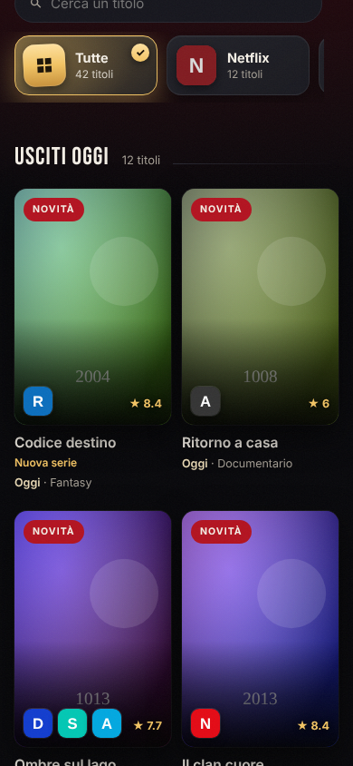 |

> Gli screenshot sono stati fatti con dati di prova (locandine segnaposto). Con la chiave TMDB vedrai locandine e titoli reali.

## Avvio rapido

Serve solo Docker, senza scaricare niente:

```bash
docker run -d --name cosaguardo -p 8080:8080 -v cosaguardo-data:/data --restart unless-stopped ghcr.io/land2595/cosaguardo:latest
```

Apri **http://localhost:8080**. Al primo avvio la pagina ti chiede la chiave TMDB, che è gratuita: crei un account su [themoviedb.org](https://www.themoviedb.org/signup), la richiedi da [Impostazioni → API](https://www.themoviedb.org/settings/api) e la incolli. La chiave viene salvata nel volume `cosaguardo-data`, quindi resta anche dopo un riavvio o un aggiornamento. Il primo caricamento del catalogo richiede circa 30 secondi.

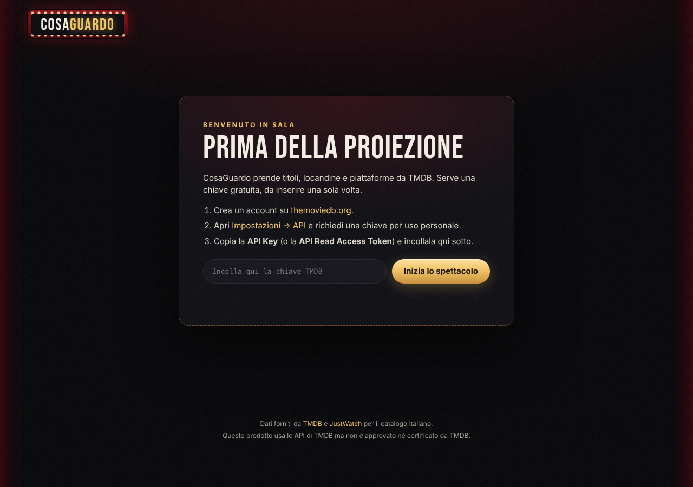

L'immagine è disponibile sia per `amd64` sia per `arm64`, quindi gira anche su Raspberry Pi, NAS e Mac con Apple Silicon.

### Con Docker Compose

Crea un file `docker-compose.yml` con questo contenuto (è lo stesso che trovi nel repository) e lancia `docker compose up -d`:

```yaml
services:
  cosaguardo:
    image: ghcr.io/land2595/cosaguardo:latest
    container_name: cosaguardo
    restart: unless-stopped
    ports:
      - "8080:8080"
    environment:
      TMDB_API_KEY: ""   # facoltativa: se vuota si inserisce dalla pagina
    volumes:
      - cosaguardo-data:/data

volumes:
  cosaguardo-data:
```

### Aggiornare

```bash
# con docker run
docker pull ghcr.io/land2595/cosaguardo:latest && docker rm -f cosaguardo
# poi rilancia il comando docker run qui sopra

# con docker compose
docker compose pull && docker compose up -d
```

## Richieste a Radarr e Sonarr

Se usi [Radarr](https://radarr.video) e [Sonarr](https://sonarr.tv), CosaGuardo può mandare loro i titoli che vuoi vedere. Basta aggiungere indirizzo e chiave API, che trovi in *Settings → General* di ciascuno:

```bash
docker run -d --name cosaguardo -p 8080:8080 -v cosaguardo-data:/data --restart unless-stopped \
  -e RADARR_URL=http://192.168.1.10:7878 -e RADARR_API_KEY=la_chiave_di_radarr \
  -e SONARR_URL=http://192.168.1.10:8989 -e SONARR_API_KEY=la_chiave_di_sonarr \
  ghcr.io/land2595/cosaguardo:latest
```

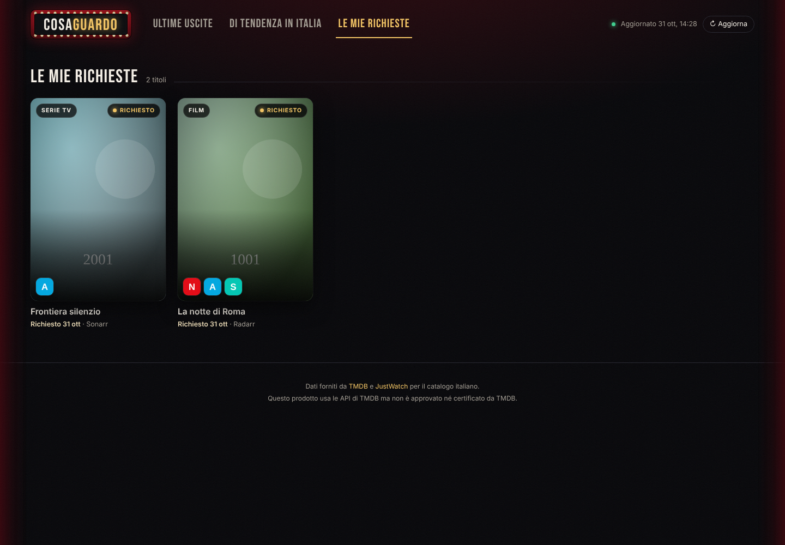

Puoi configurarne anche uno solo. Nella scheda di un titolo compare il pulsante **Richiedi a Radarr** (per i film) o **Richiedi a Sonarr** (per le serie): il titolo viene aggiunto con monitoraggio attivo e la ricerca parte subito. Se è già presente, il pulsante mostra lo stato invece di aggiungerlo di nuovo.

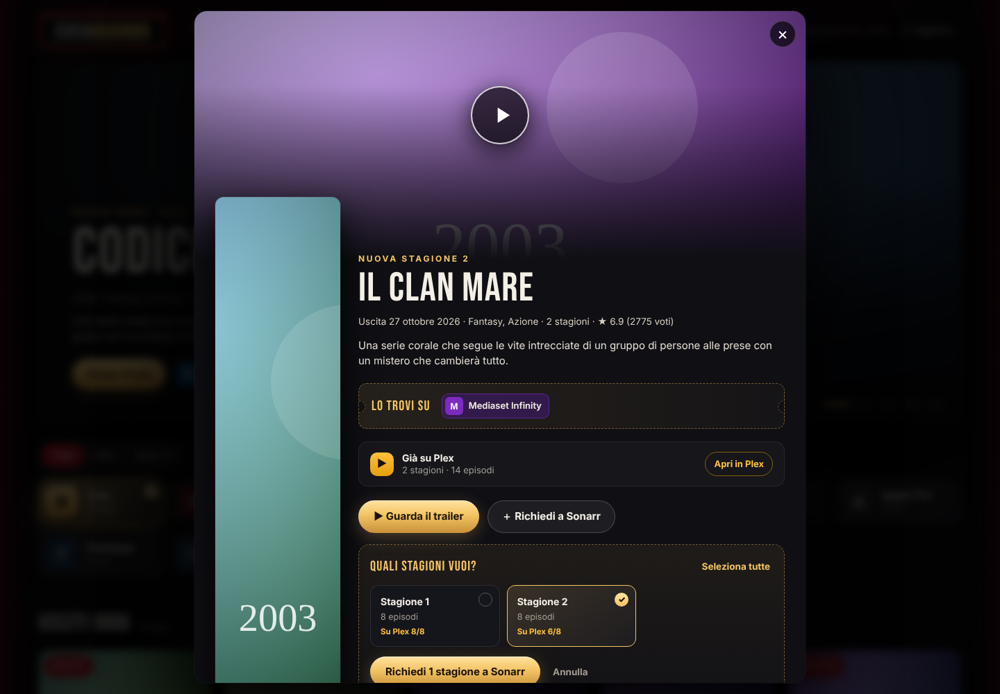

- **Stagioni**: per le serie si apre l'elenco delle stagioni, con il numero di episodi e quanti ne hai già su Plex. Puoi sceglierne alcune o tutte. Più avanti puoi aggiungerne altre con **＋ Altre stagioni**: Sonarr le monitora e le cerca subito.
- **Download**: la scheda e *Le mie richieste* mostrano la percentuale, il tempo rimanente e, per le serie, gli episodi scaricati per ogni stagione. Mentre c'è un download in corso la pagina si aggiorna da sola ogni 15 secondi.

- Usa l'indirizzo IP del computer o NAS, non `localhost`: dentro il container `localhost` è il container stesso. Se Radarr e Sonarr sono nella stessa rete Docker di CosaGuardo puoi usare il nome del container, ad esempio `http://radarr:7878`.
- Se non indichi profilo di qualità e cartella, vengono usati i primi configurati in Radarr/Sonarr. Puoi sceglierli per nome con `RADARR_QUALITY_PROFILE=HD-1080p` e `RADARR_ROOT_FOLDER=/movies` (lo stesso per Sonarr).
- Funziona con Radarr v3 o successivi e con Sonarr v3 e v4.
- Se il menu admin dice **Non raggiungibile**, accanto c'è il motivo. *Connessione rifiutata*: porta sbagliata o servizio spento. *Nessuna risposta entro il tempo limite*: il container non riesce a raggiungere quell'indirizzo, di solito perché CosaGuardo gira sullo stesso NAS e il firewall blocca la rete Docker (consenti la sottorete `172.16.0.0/12`) oppure perché il container usa una rete `macvlan`. In questi casi metti CosaGuardo nella stessa rete Docker di Radarr e Sonarr e usa il nome del container, oppure avvialo con `--network host`. Prova da dentro il container con `docker exec cosaguardo python -c "import urllib.request;print(urllib.request.urlopen('http://IP:8989/ping').read())"`.

## Menu admin

L'ingranaggio in alto a destra apre la *cabina di proiezione*, un menu protetto da PIN per regolare le impostazioni senza toccare il container.

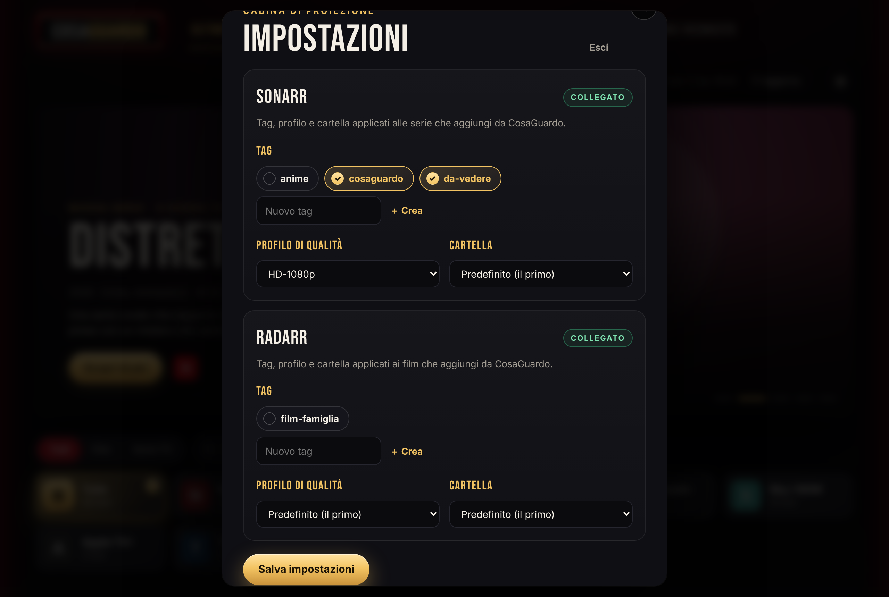

- **PIN**: la prima volta che apri il menu scegli un PIN da 4 a 8 cifre. Viene salvato in `/data/impostazioni.json` solo come hash, e puoi cambiarlo dal menu. Se preferisci fissarlo nella configurazione usa `ADMIN_PIN=1234`: in quel caso dal menu non si può cambiare. Dopo 5 PIN sbagliati il menu si blocca per 5 minuti.
- **Tag**: scegli i tag di Sonarr da applicare alle serie che aggiungi da CosaGuardo (e quelli di Radarr per i film). Puoi crearne di nuovi direttamente dal menu. I tag valgono per i titoli aggiunti da quel momento in poi.
- **Profilo di qualità e cartella**: sostituiscono `SONARR_QUALITY_PROFILE`, `SONARR_ROOT_FOLDER` e le corrispondenti di Radarr. Con *Predefinito* si torna al valore della configurazione.

Se non hai ancora scelto un PIN, il primo che apre il menu lo imposta: fallo subito dopo l'installazione, soprattutto se CosaGuardo è raggiungibile da fuori casa.

## Collegare Plex

Con Plex collegato, le locandine dei titoli che hai già mostrano **Su Plex**, e la scheda dice quante stagioni ed episodi hai e ha il pulsante **Apri in Plex**. Servono l'indirizzo del server e il token:

```bash
  -e PLEX_URL=http://192.168.1.10:32400 -e PLEX_TOKEN=il_tuo_token \
```

Per trovare il token: apri Plex Web, su un qualsiasi film clicca **⋯ → Ottieni informazioni → Visualizza XML**. Nell'indirizzo della pagina che si apre, il token è il valore dopo `X-Plex-Token=`. ([Guida ufficiale](https://support.plex.tv/articles/204059436-finding-an-authentication-token-x-plex-token/))

CosaGuardo legge la libreria ogni 10 minuti e riconosce i titoli dagli id TMDB e TVDB, quindi funziona con l'agente Plex predefinito.

## Suggeriti per te

Nella scheda di ogni titolo c'è il riquadro **Il tuo giudizio**: ♥ *Mi piace*, un voto da 0 a 5 stelle e le note su cosa ti è piaciuto (regia, personaggi, atmosfera, finale...). Più giudizi dai, e più sono precise le note, migliori sono i suggerimenti. Se non sai cosa scrivere, **✦ Suggerisci con l'AI** (solo con l'AI collegata) propone tre note di massimo 20 parole: una sola richiesta all'AI, solo quando premi. La watchlist e i titoli ignorati, salvati in `/data/liste.json`, aiutano l'AI a capire cosa ti interessa e cosa no. I giudizi sono salvati in `/data/gusti.json`; quelli che hai dato compaiono anche in fondo alla sezione *Suggeriti per te*.

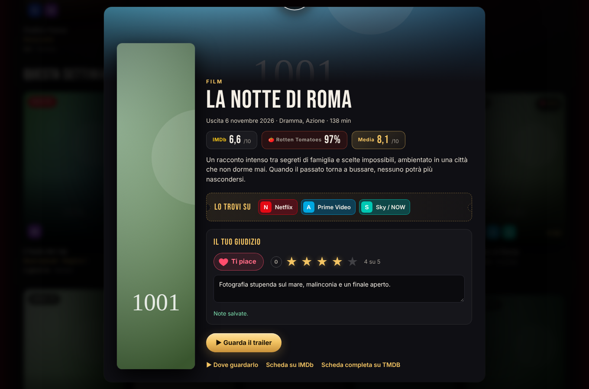

La sezione **Suggeriti per te** mostra 30 film e serie scelti tra tutto quello che è uscito negli ultimi 50 anni, non solo le novità, ognuno con il motivo per cui potrebbe piacerti. Ogni titolo viene cercato su TMDB, così hai locandina, trama, voti, piattaforme italiane (se è in streaming) e il pulsante per richiederlo a Radarr o Sonarr. Con l'AI i suggerimenti partono **solo quando premi il pulsante** (*Genera suggerimenti*, poi *Aggiorna suggerimenti* o *Nuovi suggerimenti*): mettere mi piace, votare o scrivere note non fa nessuna richiesta, il pulsante si evidenzia soltanto quando hai cambiato qualcosa. Senza AI i consigliati di TMDB (gratis) si rifanno da soli quando apri la sezione dopo aver cambiato i tuoi giudizi.

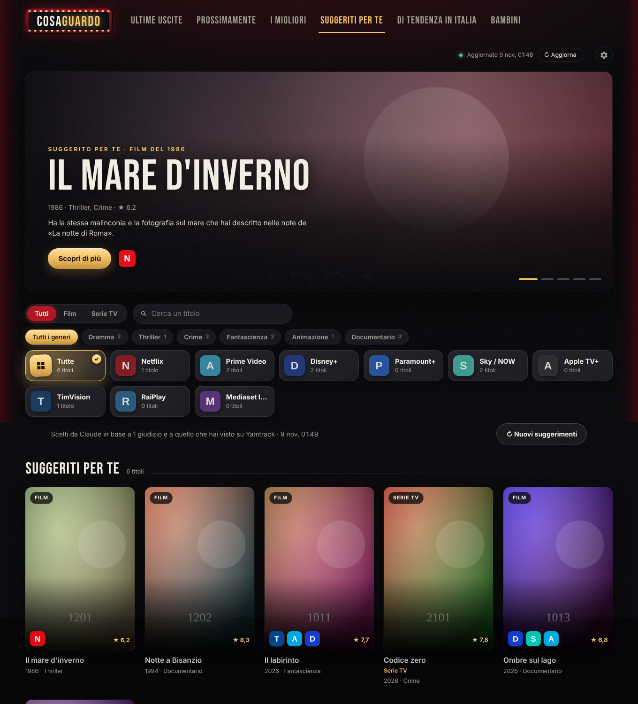

- **Con l'AI (consigliato)**: l'AI legge i tuoi giudizi e le note e sceglie titoli con le stesse qualità, non solo dello stesso genere. Ogni pressione del pulsante è una sola richiesta (pochi centesimi). Nel menu admin, sezione *Suggeriti per te · AI*, scegli il servizio:
  - **Claude**: crea una chiave API su [platform.claude.com](https://platform.claude.com/settings/keys) (o usa `ANTHROPIC_API_KEY`). Il modello predefinito è Claude Opus 5.5; dal menu puoi scegliere Sonnet o Haiku, più economici.
  - **OpenRouter / OpenAI**: funziona con qualsiasi servizio che offre l'API `/chat/completions` di OpenAI. Con [OpenRouter](https://openrouter.ai/keys) una sola chiave dà accesso ai modelli di OpenAI, Google, Anthropic, Meta e altri; l'indirizzo predefinito è `https://openrouter.ai/api/v1`. Per OpenAI usa `https://api.openai.com/v1`, per Ollama `http://IP:11434/v1`. Inserisci indirizzo, chiave e modello (il pulsante *Carica l'elenco dei modelli* mostra quelli disponibili), oppure usa `OPENAI_BASE_URL`, `OPENAI_API_KEY` e `AI_MODEL`. Se il modello non supporta le risposte strutturate, CosaGuardo chiede il JSON nel testo.

  Le chiavi dei due servizi restano salvate: cambiando servizio non perdi l'altra.

  **Profilo dei gusti (la memoria dell'AI).** A ogni aggiornamento, nella stessa richiesta, l'AI riscrive un profilo dei tuoi gusti in cinque voci (*Ama*, *Non ama*, *Autori e interpreti*, *Toni e temi*, *Da esplorare*) e lo rilegge la volta dopo. Così impara nel tempo da giudizi, note, titoli visti, watchlist e scartati, e soprattutto da come hai accolto i titoli che ti ha suggerito (voti, mi piace, *Non mi interessa*). Il profilo è nel riquadro *Profilo dei gusti* della sezione: puoi leggerlo e correggerlo, e l'AI rispetta le tue correzioni. I titoli già suggeriti non vengono riproposti, quindi ogni aggiornamento va oltre i precedenti; *Azzera* li dimentica. Tutto è salvato in `/data/profilo.json`.

  **Ricerca.** La casella *Cerca film, serie, attori* filtra la sezione aperta e sotto mostra *Altri titoli* da tutto il catalogo TMDB, di qualsiasi anno, più attori e registi: apri un titolo e dagli mi piace, stelle e note per insegnare all'AI i tuoi gusti anche su quello che hai visto in passato.
- **Senza chiave**: CosaGuardo usa i titoli che TMDB consiglia per quelli a cui hai messo mi piace o almeno 4 stelle.

### Titoli già visti: Yamtrack e Plex

I titoli già visti possono arrivare da **Yamtrack**, da **Plex** o da tutti e due. Nel menu admin, sezione *Già visti*, scegli quali usare tra quelli collegati (all'inizio sono attivi tutti). Con almeno una fonte attiva:

- le locandine dei titoli che hai visto mostrano **Visto** (o *Lo stai guardando*, *Da vedere*...) e la scheda dice da dove arriva;
- i titoli già visti non vengono suggeriti;
- i voti (da 0 a 10) vengono passati all'AI insieme ai tuoi giudizi.

Se un titolo è in entrambe, valgono lo stato e il voto di Yamtrack (il voto di Plex si usa se in Yamtrack manca).

**Da Plex** (si collega come in [Collegare Plex](#collegare-plex)) si leggono i film guardati, le serie con almeno un episodio guardato (*Visto* se le hai finite) e le stelle che hai dato in Plex. Valgono per l'account del token: se il server ha più utenti, usa il token del tuo account.

### Collegare Yamtrack

[Yamtrack](https://github.com/FuzzyGrim/Yamtrack) non ha un'API per leggere la libreria, quindi CosaGuardo entra con il tuo utente e scarica l'esportazione CSV (la stessa di *Impostazioni → Esporta*), al massimo una volta l'ora. Inserisci indirizzo, utente e password nel menu admin (o con `YAMTRACK_URL`, `YAMTRACK_USER`, `YAMTRACK_PASSWORD`). Vengono letti solo i film e le serie con fonte TMDB. Contano anche i titoli in *Da vedere*, che quindi non ti vengono suggeriti.

La password viene salvata in chiaro in `/data/impostazioni.json`: usa un utente Yamtrack dedicato se preferisci. Se usi solo l'accesso con OIDC o social, crea in Yamtrack un utente con password.

## Configurazione

Tutte le opzioni sono variabili d'ambiente (`-e NOME=valore` con `docker run`, oppure la sezione `environment` del compose). Nessuna è obbligatoria.

| Variabile | Predefinito | Descrizione |
|---|---|---|
| `TMDB_API_KEY` | | Chiave TMDB (v3) o token di lettura (v4). Se manca, la pagina la chiede al primo avvio. |
| `REFRESH_MINUTES` | `60` | Ogni quanti minuti aggiornare il catalogo. |
| `MOVIE_DAYS` | `90` | Un film è "uscita recente" se è uscito negli ultimi N giorni. |
| `TV_DAYS` | `30` | Una serie è "uscita recente" se ha avuto episodi negli ultimi N giorni. |
| `PLATFORMS` | tutte | Piattaforme da mostrare, separate da virgola: `netflix,prime,disney,paramount,sky,apple,timvision,raiplay,mediaset,discovery`. |
| `PAGES` | `5` | Pagine di risultati lette da TMDB per ogni ricerca (20 titoli per pagina). |
| `REGION` / `LANGUAGE` | `IT` / `it-IT` | Paese del catalogo e lingua dei metadati. |
| `RADARR_URL` / `RADARR_API_KEY` | | Indirizzo e chiave API di Radarr, per richiedere i film. |
| `RADARR_QUALITY_PROFILE` / `RADARR_ROOT_FOLDER` | il primo | Profilo di qualità e cartella dei film (nome o id). |
| `SONARR_URL` / `SONARR_API_KEY` | | Indirizzo e chiave API di Sonarr, per richiedere le serie. |
| `SONARR_QUALITY_PROFILE` / `SONARR_ROOT_FOLDER` | il primo | Profilo di qualità e cartella delle serie (nome o id). |
| `SONARR_LANGUAGE_PROFILE` | il primo | Solo Sonarr v3: profilo lingua (nome o id). |
| `ADMIN_PIN` | | PIN del menu admin (4-8 cifre). Se vuoto si sceglie dalla pagina. |
| `PLEX_URL` / `PLEX_TOKEN` | | Indirizzo del server Plex e token, per vedere cosa hai già. |
| `OMDB_API_KEY` | | Chiave [OMDb](https://www.omdbapi.com/apikey.aspx) (gratuita) per i voti di Rotten Tomatoes in *I migliori*. Si può inserire anche dal menu admin. |
| `OMDB_DAILY_LIMIT` | `900` | Richieste a OMDb al giorno al massimo (il piano gratuito ne permette 1.000). |
| `BEST_YEARS` | `10` | Quanti anni indietro guarda *I migliori*. |
| `BEST_HOURS` | `24` | Ogni quante ore ricalcolare *I migliori*. |
| `IMDB_RATINGS` | `1` | Usa i voti IMDb in *I migliori*. Con `0` usa solo quelli di TMDB e non scarica niente. |
| `UPCOMING_DAYS` | `60` | Quanti giorni avanti guarda la sezione *Prossimamente*. |
| `AI_PROVIDER` | | Servizio AI per *Suggeriti per te*: `anthropic` (Claude) o `openai` (OpenRouter, OpenAI o altro servizio compatibile). Se manca: `openai` quando c'è solo `OPENAI_API_KEY`, altrimenti `anthropic`. Si sceglie anche dal menu admin. |
| `ANTHROPIC_API_KEY` | | Chiave API di Anthropic (Claude). Si può inserire anche dal menu admin. |
| `OPENAI_API_KEY` | | Chiave per il servizio compatibile OpenAI (es. `sk-or-…` di OpenRouter). |
| `OPENAI_BASE_URL` | `https://openrouter.ai/api/v1` | Indirizzo dell'API compatibile OpenAI (es. `https://api.openai.com/v1`). |
| `AI_MODEL` | `claude-opus-5-5` con Claude | Modello per i suggerimenti (es. `claude-sonnet-5-5`, oppure `google/gemini-3-pro` su OpenRouter). Con OpenRouter/OpenAI è obbligatorio. |
| `YAMTRACK_URL` / `YAMTRACK_USER` / `YAMTRACK_PASSWORD` | | Il tuo Yamtrack, per i titoli già visti. Si può impostare anche dal menu admin. |
| `PUID` / `PGID` | `1000` / `1000` | Utente e gruppo con cui gira l'app e a cui appartengono i file in `/data`. Utile se monti una cartella del NAS (es. `-v /percorso/cosaguardo:/data`). |

Hulu non è presente perché non esiste in Italia: i suoi contenuti escono su Disney+.

## Come funziona

Ad ogni aggiornamento, CosaGuardo:

1. legge da TMDB l'elenco dei servizi di streaming attivi in Italia e li raggruppa per piattaforma (ad esempio "Netflix" e "Netflix con pubblicità" diventano un'unica piattaforma Netflix);
2. cerca i **film** usciti di recente e quelli arrivati in **digitale/TV in Italia** di recente, disponibili in abbonamento o gratis su quelle piattaforme;
3. cerca le **serie** nuove e quelle con **episodi o stagioni nuove**;
4. per ogni titolo legge la scheda in italiano e le piattaforme italiane su cui è disponibile, poi unisce i doppioni;
5. ordina tutto dalla data di uscita più recente e salva il risultato in `/data/catalogo.json`, così al riavvio la pagina è subito pronta.

Per **Prossimamente** cerca i film con uscita digitale o TV in Italia nelle prossime settimane e le serie (nuove o con una nuova stagione) che debuttano sulle reti delle piattaforme. **I migliori** prende, anno per anno, i film e le serie più votati e più visti, disponibili in abbonamento o gratis su una piattaforma italiana e con la trama tradotta in italiano (l'anno di una serie è quello del debutto). Esclude reality, talk show, notiziari, soap e programmi per bambini. Servono almeno 5.000 voti su IMDb per un film e 2.000 per una serie, con voto minimo 7 (dal [dataset ufficiale di IMDb](https://developer.imdb.com/non-commercial-datasets/), scaricato una volta al giorno in `/data`). La classifica segue il **Tomatometer di Rotten Tomatoes** (la percentuale di recensioni positive della critica), letto da [OMDb](https://www.omdbapi.com) e salvato in `/data/rotten-tomatoes.json` per non consumare la quota giornaliera; i titoli sotto il 70% sono esclusi. OMDb ha il Tomatometer per quasi tutti i film ma solo per poche serie: i titoli senza Tomatometer usano la media pesata di IMDb in centesimi (8,5 vale come 85%) e nella scheda mostrano il voto IMDb.

**Bambini** prende i film di genere famiglia o animazione con classificazione USA G o PG e le serie per bambini, famiglia o animazione con classificazione da TV-Y a TV-PG, ordinati per popolarità. Esclude horror, thriller, crime e guerra.

Le **categorie** dei filtri raggruppano i generi di TMDB; per le serie TMDB unisce alcuni generi (es. "Action & Adventure"), quindi una serie d'azione compare sia in *Azione* sia in *Avventura*.

I dati di disponibilità arrivano da [JustWatch](https://www.justwatch.com/it) tramite le API di [TMDB](https://www.themoviedb.org).

**Un limite da sapere:** TMDB non indica il giorno in cui un titolo è stato aggiunto a una piattaforma. Per i film CosaGuardo usa la data di uscita digitale in Italia quando c'è (altrimenti la data di uscita), per le serie la data dell'ultimo episodio. Un film vecchio appena aggiunto al catalogo di una piattaforma quindi non compare tra le ultime uscite.

Per i titoli **in arrivo** TMDB non sa ancora su quale piattaforma usciranno. CosaGuardo lo ricava dalla nota di uscita italiana, dalla casa di produzione (es. Netflix, Disney, Apple) o dalla rete che produce la serie. Qualche titolo, soprattutto Sky Original, può quindi comparire senza piattaforma o mancare.

## API

| Endpoint | Descrizione |
|---|---|
| `GET /api/catalogo` | Ultime uscite, prossimamente, da non perdere, tendenze e piattaforme. Filtri opzionali: `tipo=movie\|tv`, `piattaforma=netflix` (ripetibile), `q=titolo`. |
| `GET /api/stato` | Ora dell'ultimo aggiornamento ed eventuali errori. |
| `POST /api/aggiorna` | Forza un aggiornamento immediato. |
| `GET /api/trailer/{movie\|tv}/{id}` | Il trailer YouTube del titolo, in italiano se disponibile. |
| `GET /api/richieste` | Le richieste fatte, con stato, download in corso e presenza su Plex. |
| `GET /api/richieste/{id}` | Stato di un titolo (es. `tv-123`): Radarr/Sonarr, download, Plex stagione per stagione e, per le serie, prossima uscita o fine della serie. |
| `GET /api/serie/{tmdb_id}/stagioni` | Le stagioni di una serie, con episodi richiesti, scaricati e presenti su Plex. |
| `POST /api/richieste` | Richiede un titolo (`{"id": "movie-123"}`): i film vanno a Radarr, le serie a Sonarr. Per le serie puoi indicare le stagioni: `{"id": "tv-123", "stagioni": [1, 2]}` (senza, le richiede tutte). |
| `GET /api/admin` | Se il PIN è impostato e se la sessione (header `X-Admin-Token`) è valida. |
| `POST /api/admin/pin` / `POST /api/admin/accesso` | Imposta il PIN la prima volta / entra con il PIN (`{"pin": "1234"}`). Restituiscono il token di sessione. |
| `GET` / `PUT /api/admin/impostazioni` | Tag, profilo di qualità e cartella di Sonarr e Radarr (serve il token). |
| `POST /api/admin/tag` | Crea un tag in Sonarr o Radarr: `{"servizio": "sonarr", "nome": "da-vedere"}` (serve il token). |
| `GET /api/plex` | Gli id TMDB dei film e delle serie già presenti su Plex. |
| `GET /api/voti/{movie\|tv}/{id}` | Voti IMDb e Rotten Tomatoes di un titolo, con la media in decimi. |
| `DELETE /api/richieste/{id}` | Toglie un titolo da *Le mie liste → Richieste*. Non cancella niente da Radarr, Sonarr o Plex. |
| `GET /api/liste` | La watchlist e i titoli ignorati: `{"watchlist": [...], "ignorati": [...]}`. |
| `PUT /api/liste/{lista}/{id}` | Aggiunge un titolo a `watchlist` o `ignorati` (lo toglie dall'altra lista). |
| `DELETE /api/liste/{lista}/{id}` | Toglie un titolo da una lista (per gli ignorati: lo ripristina). |
| `POST /api/gusti/{id}/note-ai` | Tre note brevissime (max 20 parole) proposte dall'AI per quel titolo. Non salva niente. |
| `GET /api/gusti` | I tuoi giudizi (mi piace, voto, note). |
| `PUT /api/gusti/{id}` | Aggiorna il giudizio di un titolo: `{"mi_piace": true, "voto": 4, "note": "..."}` (ogni campo è facoltativo; `"voto": null` lo toglie). |
| `GET /api/suggeriti` | *Suggeriti per te*, con il profilo dei gusti (senza AI, se i giudizi sono cambiati, li ricalcola in background). `POST /api/suggeriti/aggiorna` li rifà subito. |
| `GET` / `PUT /api/profilo`, `DELETE /api/profilo/storico` | Il profilo dei gusti usato dall'AI (leggerlo, correggerlo) e i titoli già suggeriti (azzerarli). |
| `GET /api/cerca?q=` | Ricerca libera di film, serie e persone su TMDB. |
| `GET /api/visti` | I titoli già visti (da Yamtrack e/o Plex), con stato, voto e fonte. |
| `GET` / `PUT /api/admin/ai`, `POST /api/admin/ai/modelli` | Servizio, chiave e modello dell'AI; elenco dei modelli di un servizio compatibile OpenAI (serve il token). |
| `GET` / `PUT /api/admin/yamtrack`, `GET` / `PUT /api/admin/visti` | Collegamento a Yamtrack e fonti dei titoli già visti (serve il token). |
| `POST /api/chiave` | Imposta la chiave TMDB (solo se non è ancora configurata). |
| `GET /health` | Controllo di salute per Docker. |

## Sviluppo

```bash
git clone https://github.com/land2595/cosaguardo.git && cd cosaguardo
docker build -t cosaguardo .        # immagine locale

pip install -r requirements.txt pytest
pytest -q tests

# Prova senza chiave e senza rete, con finti TMDB, Radarr e Sonarr
uvicorn tests.mock_tmdb:app --port 9000 &
uvicorn tests.mock_arr:radarr --port 7878 &
uvicorn tests.mock_arr:sonarr --port 8989 &
uvicorn tests.mock_arr:plex --port 32400 &
TMDB_API_KEY=test TMDB_BASE_URL=http://127.0.0.1:9000 \
TMDB_IMAGE_URL=http://127.0.0.1:9000/img DATA_DIR=./data \
RADARR_URL=http://127.0.0.1:7878 RADARR_API_KEY=test \
SONARR_URL=http://127.0.0.1:8989 SONARR_API_KEY=test \
PLEX_URL=http://127.0.0.1:32400 PLEX_TOKEN=plex-test \
uvicorn app.main:app --reload --port 8080
```

Struttura:

```
app/
  config.py      piattaforme e impostazioni
  catalog.py     raccolta dati da TMDB, unione dei doppioni, trailer, cache
  admin.py       menu admin: PIN e impostazioni salvate in /data
  arr.py         richieste a Radarr e Sonarr
  liste.py       watchlist e titoli ignorati
  main.py        server FastAPI e aggiornamento periodico
  static/        interfaccia (HTML, CSS, JS, font)
tests/           test e finto server TMDB
```

---

Questo prodotto usa le API di TMDB ma non è approvato né certificato da TMDB. I font Bebas Neue e Inter sono distribuiti con licenza SIL Open Font License.
